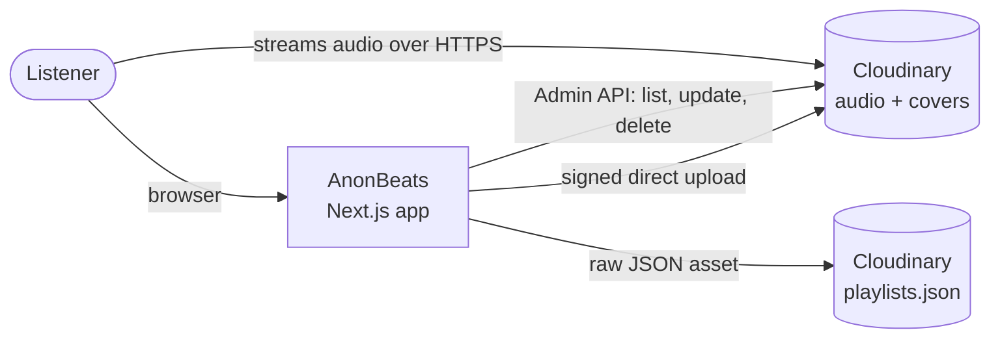
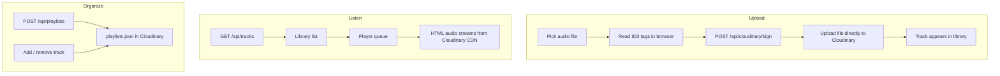

# AnonBeats: High-Level Design

A personal, ad-free music player: upload your own songs, organize them into playlists, and stream them anywhere. Live at [beats.minianon.in](https://beats.minianon.in). For code-level detail see the [Low-Level Design](lld.md).

## 1. System context

There is no database. Cloudinary stores the audio files (as `video` resources), their metadata (title, artist, album, cover in each asset's context), and the playlists (one raw JSON file).

## 2. Components

| Component | Responsibility |
|---|---|
| Password gate (`middleware.ts`, `/welcome`) | Redirects every page to `/welcome` until the `ab_auth` cookie is set by the unlock endpoint |
| Library page | Lists all tracks, play, like, edit details, delete |
| Upload page | Reads tags from the file in the browser, gets a signature, uploads straight to Cloudinary |
| Playlists pages | Create, open, add and remove tracks; built-in "Liked songs" playlist |
| Player (context + `PlayerBar`) | Global queue, play / pause / next / previous, seek, volume, repeat |
| API routes | Sign uploads, list / update / delete tracks, CRUD playlists, unlock / logout |
| Cloudinary | Media storage, CDN streaming, metadata, playlist JSON |

## 3. Key flows

## 4. Tech stack

| Layer | Choice |
|---|---|
| Framework | Next.js 15 (App Router, route handlers) + React 19 + TypeScript |
| Styling and motion | Tailwind CSS, Framer Motion, Lucide icons |
| Audio | HTML `<audio>` element, WaveSurfer.js visuals, `music-metadata-browser` for tags |
| Storage and CDN | Cloudinary (Admin API, signed uploads, raw JSON asset) |
| Hosting | Vercel |

## 5. Data

| Data | Where | Shape |
|---|---|---|
| Audio files | Cloudinary `video` resources under `CLOUDINARY_FOLDER` (default `anonbeats/tracks`) | file + `context`: title, artist, album, coverUrl |
| Playlists | Cloudinary raw asset `anonbeats/meta/playlists.json` | `{ version, updatedAt, playlists: [{ id, name, createdAt, itemIds[], coverUrl? }] }` |
| Liked songs | A playlist with id `liked` | newest liked first |
| Unlock state | Browser cookie `ab_auth=yes` (30 days) | |

## 6. Quality attributes

| Attribute | Approach |
|---|---|
| Cost | No database or server storage; Cloudinary free tier covers a personal library |
| Upload speed | Files go browser → Cloudinary directly; the server only signs |
| Consistency | Deleting a track also removes it from every playlist |
| Privacy | Personal use behind a simple password gate |
| Known limits | The gate is not real authentication (a cookie value); playlists are one JSON file, so concurrent edits from two devices can overwrite each other; library listing returns up to 200 tracks |
