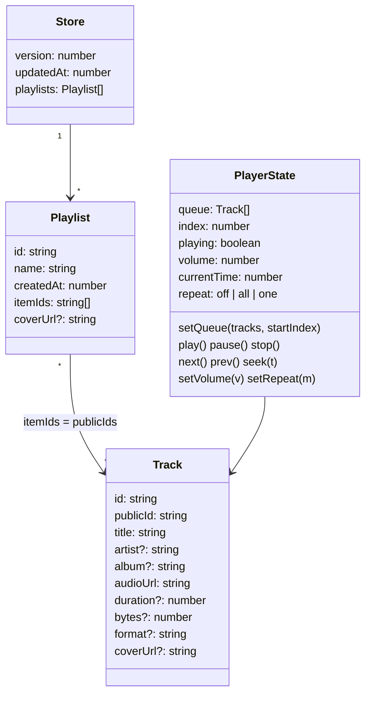
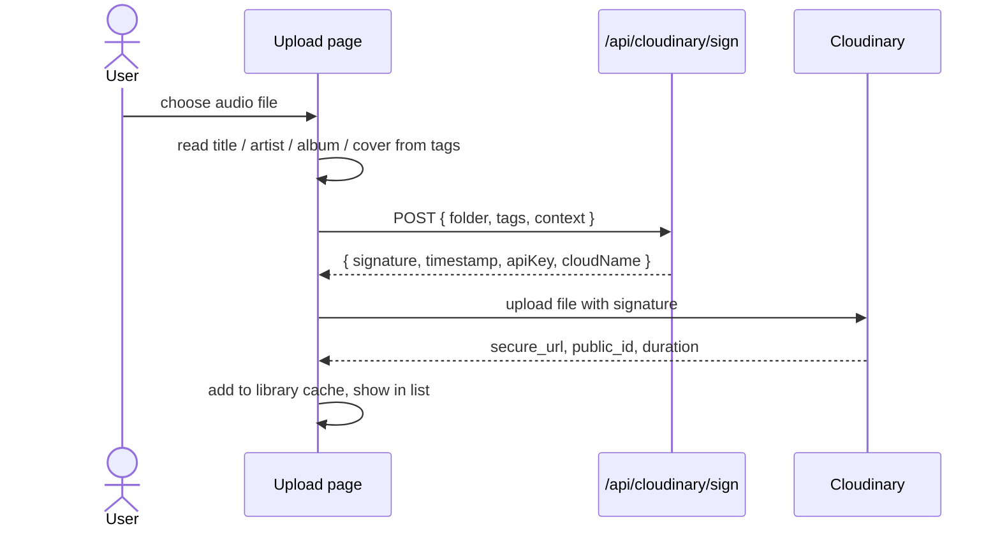
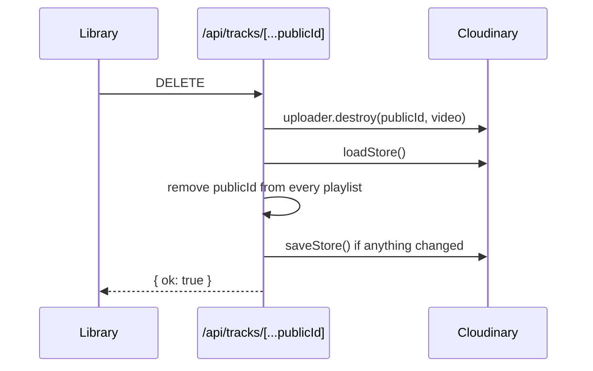

# AnonBeats: Low-Level Design

Routes, data types and key sequences. For the big picture see the [High-Level Design](hld.md).

## 1. Source layout

| Path | Role |
|---|---|
| `src/middleware.ts` | Password gate: lets assets, `/welcome` and auth endpoints through, redirects the rest |
| `src/app/welcome` | Unlock screen; returns to the page in `?continue=` after unlocking |
| `src/app/library` | Library page |
| `src/app/upload` | Upload page (`UploadClient.tsx`) |
| `src/app/playlists`, `src/app/playlists/[id]` | Playlist list and playlist detail |
| `src/app/api/...` | Route handlers (below) |
| `src/lib/player-context.tsx` | Global player state and controls |
| `src/lib/likes-context.tsx` | Liked-track IDs backed by the `liked` playlist |
| `src/lib/library.ts` | `Track` type and a localStorage cache of known tracks |
| `src/components/ui/PlayerBar.tsx` | Bottom player UI |

## 2. API

| Method | Route | Body / query | Result |
|---|---|---|---|
| POST | `/api/auth/unlock` | `{ password }` | Sets `ab_auth=yes` cookie, or 401 |
| POST | `/api/auth/logout` | | Clears the cookie |
| POST | `/api/cloudinary/sign` | `{ folder?, tags?, context?, public_id? }` | `{ timestamp, signature, apiKey, cloudName, folder, ... }` |
| GET | `/api/tracks` | | Track list, newest first (Admin API, up to 200) |
| PATCH | `/api/tracks/[...publicId]` | `{ title?, artist?, album?, coverUrl? }` | Updates the asset's context |
| DELETE | `/api/tracks/[...publicId]` | | Deletes the asset, then removes it from all playlists |
| GET | `/api/playlists` | `?debug=1` returns the raw store | Playlists, newest first |
| POST | `/api/playlists` | `{ name, id?, coverUrl? }` | Creates, or updates name / cover if `id` exists |
| GET | `/api/playlists/:id` | | One playlist or `null` |
| DELETE | `/api/playlists/:id` | | Deletes (the `liked` playlist cannot be deleted) |
| POST | `/api/playlists/:id/tracks` | `{ publicId }` | Adds a track (front for `liked`, end otherwise, no duplicates) |
| DELETE | `/api/playlists/:id/tracks` | `?publicId=` | Removes a track |

## 3. Types

## 4. Playlist store

`_store.ts` keeps all playlists in one Cloudinary raw file, `anonbeats/meta/playlists.json`.

| Function | Behavior |
|---|---|
| `loadStore()` | Looks up the asset by ID (with and without `.json`), falls back to a prefix search, fetches it with a cache-busting query; returns an empty store if none exists |
| `saveStore(store)` | Sets `updatedAt`, uploads the JSON as base64 with `overwrite: true` and `invalidate: true` |

Every playlist change is load → modify → save of the whole file.

## 5. Sequences

### Upload a song

### Delete a track

## 6. Player rules

| Behavior | Rule |
|---|---|
| Start | `setQueue(tracks, startIndex)` replaces the queue and starts playing |
| Previous | Restarts the current track if more than 3 seconds in, otherwise goes back |
| Repeat | `off`, `all` (wrap around the queue) or `one` |
| Stop | Pauses, resets time and clears the queue so the audio element loses its source |

## 7. Configuration

| Variable | Purpose |
|---|---|
| `CLOUDINARY_CLOUD_NAME`, `CLOUDINARY_API_KEY`, `CLOUDINARY_API_SECRET` | Cloudinary account (secret is server-only) |
| `CLOUDINARY_FOLDER` | Folder for audio uploads, default `anonbeats/tracks` |
| `GATE_PASSWORD` | Password for the unlock screen; must be set in production |
